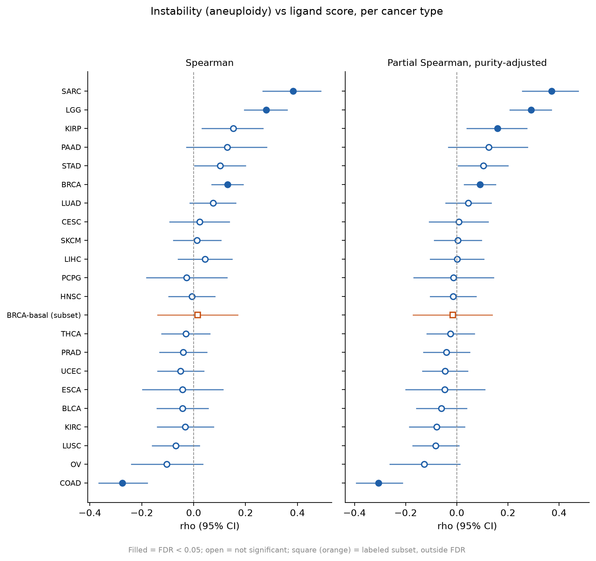
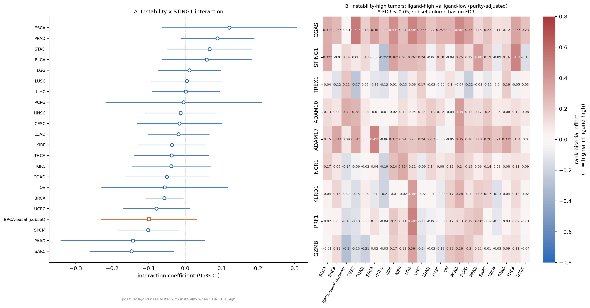

# Genomic instability and NKG2D ligand expression across TCGA tumors

**Status:** analysis run on real TCGA data on 25 November 2026. Everything below comes from that run.
All results are associations in bulk tumors. See "What this cannot resolve".




## Question
Within each cancer type, do tumors with more genomic instability express more NKG2D ligand mRNA, and does
STING1 expression change that relationship? This is a descriptive check of the premise behind my PhD aim on
stress-state control of surface NKG2D ligands in triple-negative breast cancer. It cannot test causes.

## Data
All files were downloaded on 25 November 2026.

GDC PanCanAtlas supplemental files:
- RNA: EBPlusPlusAdjustPANCAN_IlluminaHiSeq_RNASeqV2.geneExp.tsv (batch-corrected pan-cancer RSEM)
- Aneuploidy scores: PANCAN_ArmCallsAndAneuploidyScore_092817.txt (Taylor et al. 2018)
- Purity: TCGA_mastercalls.abs_tables_JSedit.fixed.txt (ABSOLUTE)
- TP53 status (optional): mc3.v0.2.8.PUBLIC.maf.gz
- PAM50 subtype for BRCA: cBioPortal, Breast Invasive Carcinoma (TCGA, PanCancer Atlas), clinical data table
- Fraction genome altered and MSI MANTIS score: cBioPortal, TCGA PanCancer Atlas studies, pan-cancer clinical
  data table (30 of 32 studies; GBM and KICH are absent, and neither reaches the 150-tumor cutoff)
- CIN70 list: not used (gene list not obtained, so the CIN70 check was not run)

## Choices fixed before looking at results (config.py)
- Primary instability measure: aneuploidy score. Secondary: fraction of genome altered (FGA).
- Primary outcome: ligand score, the mean within-type z-score of MICA, MICB, ULBP1, ULBP2, ULBP3,
  RAET1E (ULBP4) and RAET1G (ULBP5). Per-ligand results are supplementary.
- Every analysis runs within a cancer type, never pooled. Types need at least 150 complete tumors.
- "Instability-high" is the top third within each type. Ligand-high vs ligand-low splits at the median
  ligand score inside the instability-high group.
- Purity is a covariate everywhere. TP53 mutation is a covariate in the interaction model.
- Multiple testing: Benjamini-Hochberg over cancer types. The BRCA basal-like subset is labeled and sits
  outside the FDR family.

## Run order
```
pip install -r requirements.txt
python 00_build_phenotype.py   # merge cancer type, aneuploidy score, purity (+ TP53, PAM50 if downloaded)
python 01_prepare.py      # filter, z-score, score, write data_processed/analysis_table.csv.gz
python 02_figure1.py      # instability vs ligand score per cancer type (+ per-ligand supplement)
python 03_figure2.py      # instability x STING1 interaction (A) and ligand-high vs ligand-low (B)
python 04_robustness.py   # other instability measures, top quarter, purity-high, leave-one-type-out
```
To test the code without real data: `python tests/make_synthetic.py`, then run the four scripts with
`CIN_DATA_DIR=tests/synthetic_data CIN_OUT_DIR=tests/synthetic_out` (the synthetic files mimic the real
download formats, so `00_build_phenotype.py` runs on them too). Synthetic output must never be reported.

## Methods in brief
Primary tumors only, one sample per patient (SKCM: metastatic samples preferred). Expression z-scored within
each type. Figure 1: Spearman correlation with a Bonett-Wright confidence interval, and a purity-adjusted
partial Spearman correlation (ranks, residualized on purity). Figure 2A: per type, OLS of ligand score on
instability, STING1, their product, purity and TP53, all continuous variables rank-inverse-normal transformed,
HC3 robust errors; the product term asks whether STING1 changes the instability-ligand slope.
Figure 2B: Mann-Whitney tests with rank-biserial effect sizes.

## Results
9,565 primary tumors from 32 cancer types were prepared. 21 types had at least 150 complete tumors and were
analysed. Types below the cutoff, not analysed: ACC, CHOL, DLBC, GBM (n=144), KICH, MESO, READ (n=138), TGCT
(n=149), THYM, UCS, UVM. Full numbers are in `results/`.

**Figure 1: aneuploidy vs ligand score, purity-adjusted.** There is no consistent relationship across cancer
types. The median partial rho is -0.012, 10 of 21 types are positive, and 5 pass FDR below 0.05: SARC (+0.37),
LGG (+0.29), KIRP (+0.16) and BRCA (+0.09) are positive, and COAD (-0.31) is negative. BRCA and KIRP only just
pass (q = 0.019 and 0.038). Table: `results/fig1_aneuploidy_ligand_score.csv`.

**BRCA basal-like subset (TNBC proxy), labeled and outside FDR:** n = 162, partial rho = -0.016 (95% CI -0.170
to 0.139). This is a null with a wide interval, so it cannot rule out a moderate effect in either direction.

**Figure S1: per ligand (exploratory).** The ligands move in different directions, so the averaged ligand score
hides ligand-specific effects. ULBP1 and ULBP2 tend to rise with aneuploidy (BRCA, LGG, SARC, PAAD), while
RAET1E and RAET1G tend to fall (KIRC, LUSC, COAD, OV). In HNSC, ULBP1 is +0.27 and RAET1E is -0.24, so the
averaged score is near zero. I did not build a new score from this pattern, because that would fit the data.

**Figure 2A: instability x STING1 interaction.** No cancer type passes FDR (21 types, median beta = -0.018,
smallest q = 0.171). STING1 mRNA level does not modify the aneuploidy-ligand relationship in bulk tumors. This
is a weak test, because bulk STING1 mRNA largely reflects immune and stromal cells, and STING silencing in
tumor cells is epigenetic. BRCA basal-like subset: beta = -0.100 (95% CI -0.231 to 0.031).

**Figure 2B: ligand-high vs ligand-low among the most unstable tumors (descriptive), purity removed first.**
27 of 189 gene-by-type tests pass FDR (21 types x 9 genes). CGAS is higher in ligand-high tumors in 9 types
(mean effect +0.39), ADAM17 in 7 (+0.32), STING1 in 6 (5 higher and HNSC lower; mean +0.25), and NK markers
in 5 tests (3 of them in LGG). TREX1 and ADAM10 show no differences. The direction fits cGAS-STING involvement,
but CGAS and STING1 are interferon-stimulated and are expressed by immune and stromal cells, so this cannot
separate tumor-intrinsic sensing from infiltration. ADAM17 mRNA is not evidence of shedding.

**Robustness (`results/robustness.csv`):**
- Purity-high tumors only: median partial rho -0.026 (sign agrees with the primary result in 19 of 21 types);
  the interaction stays null. The pooled null held, but the set of significant types shifts (3 positive and
  3 negative instead of 4 and 1).
- Leave-one-type-out: median partial rho stays between -0.014 and -0.006. No single type drives it.
- Top quarter instead of top third (Figure 2B): 19 tests pass FDR, all positive. The direction held.
- FGA as the instability measure: median partial rho +0.043, positive in 15 of 21, 6 types pass FDR (5
  positive); sign agrees with aneuploidy in only 14 of 21 types. The interaction stays null (median -0.028).
  **This weakened the result.** The pooled picture is weak under both measures, but the sign of the median
  flips and the tissues that show a signal depend on how instability is measured.
- Excluding MSI-high tumors (MANTIS score above 0.4; 403 tumors): median -0.012, 5 types pass FDR (all
  positive). The negative COAD result largely disappears (rho -0.306 to -0.102, q 0.24), and STAD becomes
  positive (+0.104 to +0.187, q = 0.006). One type, SARC, shows a significant negative interaction after exclusion
  (beta -0.172, q = 0.020; primary q = 0.171). This is the opposite of the hypothesis, and it is fragile: only 2
  SARC tumors were removed. `05_msi_fig2a.py` reproduces it.

**Departures from the plan, reported openly:**
- The first run of Figure 2B did not remove purity before comparing groups and gave 47 significant tests. I
  corrected this so purity is removed first (27 tests). Both versions are saved in `results/`.
- The MSI exclusion was proposed after seeing the COAD result, so it is a post hoc sensitivity analysis. The
  primary analysis keeps all tumors.
- CGAS is matched by its Entrez ID because this older file does not label it by its current symbol.
- The CIN70 check was not run.

## What this cannot resolve
- Bulk mRNA is not surface protein, and TCGA cannot see shedding. ADAM10 and ADAM17 mRNA say little about
  sheddase activity. Ligand regulation is also largely post-transcriptional, so weak correlations are plausible.
- Aneuploidy and fraction of genome altered measure chromosomal instability. They are not replication stress or
  cytosolic DNA, which is what the proposed aim is about.
- STING1, CGAS and the NK markers come heavily from immune and stromal cells in bulk tumors. Purity
  adjustment helps but does not isolate tumor-intrinsic expression.
- Microsatellite-unstable tumors have low aneuploidy but strong immune infiltrate, which can distort
  patterns in colon, uterine and stomach cancers. Removing them changed the COAD and STAD results (see above).
- LGG and SARC mix molecular subtypes that differ in both instability and expression, which may contribute
  to their positive results. This was not tested.
- PAM50 basal-like is a proxy for TNBC, not the same set of tumors.
- All results are associations in bulk tumors. None of them show a cause.
